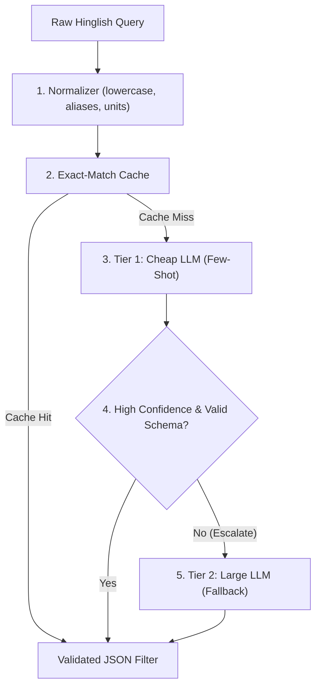

# Hinglish Query Understanding Engine

An enterprise-grade, cost-aware model cascade that extracts structured search filters from messy, colloquial Hinglish real estate queries (e.g., *"noida me 2bhk sasta near metro"*, *"gurgaon 3 bhk ready to move 1.5 cr tak"*).

---

## 🎯 Pre-Registered Success Target
> **"The cascade's field-level F1 is within 3 points of the large-LLM baseline (B3), judged by a paired bootstrap on the F1 difference where the lower bound of the 95% CI is above -3, at under 25% of B3's cost per 1k queries."**

---

## 🏗️ Architecture Overview



---

## 📂 Project Structure

```text
├── configs/               # Domain configurations, prompts, and dated pricing
│   ├── prices.yaml        # Dated model pricing table
│   └── real_estate.yaml   # Real estate schema, aliases, units, prompts (Phase 1)
├── src/                   # Core pipeline modules
│   ├── config.py          # Safe YAML loader with root resolution
│   ├── normalizer.py      # Hinglish text and unit normalizer (Phase 1)
│   ├── schema.py          # Pydantic filter schemas (Phase 1)
│   ├── llm.py             # Provider API wrapper with log-probs (Phase 2)
│   ├── baselines.py       # B1 (regex), B2 (cheap), B3 (large) (Phase 2)
│   ├── cascade.py         # Cost-aware router logic (Phase 3)
│   ├── confidence.py      # Log-prob and self-consistency metrics (Phase 4)
│   ├── cache.py           # Exact & semantic cache with wrong-hit guard (Phase 5)
│   └── api.py             # FastAPI service (Phase 6)
├── data/                  # Labeled evaluation and synthetic training data
│   └── labeling_guide.md  # Annotation rules for ambiguous queries (Phase 1)
├── eval/                  # Evaluation harness and statistical scoring
│   ├── metrics.py         # Field-level F1, paired bootstrap CIs, cost (Phase 2)
│   ├── run_eval.py        # Benchmark orchestrator (Phase 2)
│   └── results/           # Raw outputs and evaluation reports
├── tests/                 # Unit and regression test suite
├── DECISIONS.md           # Architectural decision records and interview rationales
├── requirements.txt       # Pinned production and test dependencies
└── .env.example           # Environment variable template
```

---

## 🚀 Getting Started

### 1. Environment Setup
```bash
python -m venv .venv
# On Windows:
.venv\Scripts\activate
# On Linux/macOS:
source .venv/bin/activate

pip install -r requirements.txt
```

### 2. Configuration
Copy the `.env.example` file to `.env` and supply your API keys:
```bash
cp .env.example .env
```

### 3. Run Tests
```bash
pytest
```
