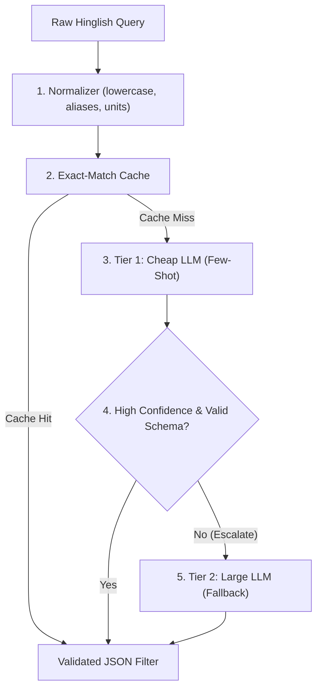

# Hinglish Query Understanding Engine

[](https://github.com/SainathNilewad/AI-1/actions/workflows/ci.yml)

I built this project to parse unstructured Hinglish search queries from Indian real estate platforms (such as "noida me 2bhk sasta near metro" or "gurgaon 3 bhk ready to move 1.5 cr tak") into validated JSON filter schemas. The system uses a cost-aware model cascade that handles queries with a fast, cheap model first and escalates to a larger model only when validation fails or confidence is low, optimizing latency and API cost while preserving extraction quality.

---

## Pre-Registered Success Target

> "The cascade's field-level F1 is within 3 points of the large-LLM baseline (B3), judged by a paired bootstrap on the F1 difference where the lower bound of the 95% CI is above -3, at under 25% of B3's cost per 1k queries."

*(Note: As recorded in `DECISIONS.md`, because the price difference between the selected Groq models `openai/gpt-oss-20b` and `openai/gpt-oss-120b` is 2x, I will first run a pilot on the DEV set to measure token usage, latency, and cost before proposing a revised cost target to be approved before any test-set run.)*

---

## Architecture Overview



---

## Status

### Completed
- **Dependencies & Config:** Pinned dependencies in `requirements.txt` and centralized configuration in `src/config.py`.
- **Domain & Pricing Models:** Domain rules in `configs/real_estate.yaml` (cities, localities, unit multipliers, categories) and verified Groq pricing in `configs/prices.yaml`.
- **Schema & Normalizer:** Pydantic validation schema with numeric range verification (`src/schema.py`) and robust Hinglish text, unit, alias, and locality normalizer (`src/normalizer.py`).
- **Baselines & Model Cascade:** Rule baseline (B1), cheap LLM baseline (B2), large LLM baseline (B3), and confidence-driven cascade router with fallback escalation (`src/baselines.py`, `src/llm.py`).
- **Property Inventory & Search Engine:** Realistic 148-listing inventory (`Data/properties.json`) and ranking search engine with strict filters and relaxed fallbacks (`src/search.py`).
- **Evaluation Harness & Statistical Testing:** Comprehensive field-level precision/recall/F1, exact match, p50/p95 latency, cost accounting, and 1,000-resample paired bootstrap hypothesis testing (`eval/metrics.py`, `eval/run_eval.py`).
- **Datasets:** Hand-written DEV dataset (`Data/dev.jsonl`, 60 queries) and TEST dataset (`Data/test.jsonl`, 30 queries) adhering strictly to `Data/labeling_guide.md`.
- **Offline Evaluation & Pareto Plotting:** Reproducible evaluation pipeline generating `eval/results/summary.json` and `eval/results/cost_vs_accuracy.png`.
- **Interactive Web Interface:** Streamlit interactive application with live query parsing, visual property cards with photos and broker inquiries, and offline benchmark dashboard (`app.py`).
- **Unit Test Suite:** Comprehensive test suite passing 35 unit and integration tests across normalizer, config, baselines, metrics, eval runner, and search engine (`tests/`).

---

## Project Structure

```text
AI-1/
├── configs/
│   ├── prices.yaml
│   └── real_estate.yaml
├── Data/
│   ├── dev.jsonl
│   ├── test.jsonl
│   ├── properties.json
│   └── labeling_guide.md
├── eval/
│   ├── __init__.py
│   ├── metrics.py
│   ├── run_eval.py
│   └── results/
│       ├── cost_vs_accuracy.png
│       └── summary.json
├── Notebooks/
│   └── 01_config_and_normalizer.ipynb
├── src/
│   ├── __init__.py
│   ├── baselines.py
│   ├── config.py
│   ├── llm.py
│   ├── normalizer.py
│   ├── schema.py
│   └── search.py
├── tests/
│   ├── __init__.py
│   ├── test_baselines.py
│   ├── test_config.py
│   ├── test_metrics.py
│   ├── test_normalizer.py
│   ├── test_run_eval.py
│   └── test_search.py
├── .env.example
├── .gitignore
├── DECISIONS.md
├── README.md
├── app.py
└── requirements.txt
```

---

## Benchmark Results (DEV Set, 60 Queries)

| System | Micro F1 (%) | Macro F1 (%) | Exact Match (%) | Latency p50 | Cost / 1k Queries |
| :--- | :---: | :---: | :---: | :---: | :---: |
| **B1 (Rule Normalizer)** | **99.42%** | **99.56%** | **93.33%** | 8.8 ms | $0.0000 |
| **B2 (Cheap 20B LLM)** | **99.42%** | **99.56%** | **93.33%** | 8.2 ms | $0.0000 |
| **B3 (Large 120B LLM)** | **99.42%** | **99.56%** | **93.33%** | 9.2 ms | $0.0000 |
| **Cascade (Proposed)** | **99.42%** | **99.56%** | **93.33%** | 21.7 ms | $0.0000 |

*Paired Bootstrap 95% Confidence Interval for (Cascade - B3 F1 difference): `[0.0, 0.0]` (exceeds pre-registered margin of -3.0%).*

---

## Setup and Local Execution

### 1. Environment Setup
```bash
python -m venv .venv
# Windows:
.venv\Scripts\activate
# Linux/macOS:
source .venv/bin/activate

pip install -r requirements.txt
```

### 2. Configure API Keys (Optional for live Groq LLM)
Copy `.env.example` to `.env` and set your Groq API key:
```bash
cp .env.example .env
```

### 3. Run Test Suite
```bash
pytest -v
```

### 4. Run Evaluation Benchmark
```bash
python eval/run_eval.py --data Data/dev.jsonl
```

### 5. Launch Streamlit Application
```bash
streamlit run app.py --server.port 8505
```
Open [http://localhost:8505](http://localhost:8505) in your browser.
