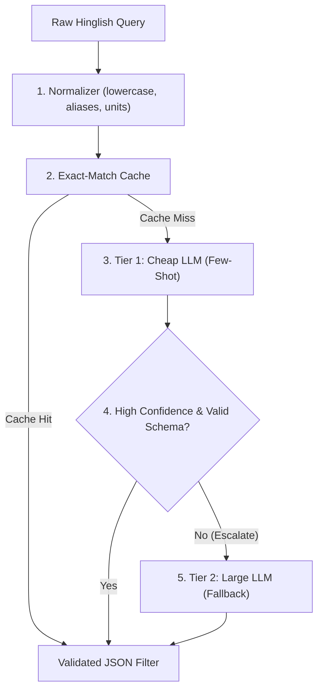

# Hinglish Query Understanding Engine

[](https://github.com/SainathNilewad/AI-1/actions/workflows/ci.yml)

I built this project to parse unstructured Hinglish search queries from Indian real estate platforms (such as "noida me 2bhk sasta near metro" or "gurgaon 3 bhk ready to move 1.5 cr tak") into validated JSON filter schemas. The system uses a cost-aware model cascade that handles queries with a fast, cheap model first and escalates to a larger model only when validation fails or confidence is low, optimizing latency and API cost while preserving extraction quality.

---

## Pre-Registered Success Target

> "The cascade's field-level F1 is within 3 points of the large-LLM baseline (B3), judged by a paired bootstrap on the F1 difference where the lower bound of the 95% CI is above -3, at under 25% of B3's cost per 1k queries."

*(Note: As recorded in `DECISIONS.md`, because the price difference between the selected Groq models `openai/gpt-oss-20b` and `openai/gpt-oss-120b` is 2x, I will first run a pilot on the DEV set to measure token usage, latency, and cost before proposing a revised cost target to be approved before any test-set run.)*

---

## Architecture Overview



---

## Status

### Completed
- Pinned dependencies in `requirements.txt`.
- Project configuration system in `src/config.py` with project root path resolution.
- Model pricing table in `configs/prices.yaml` (Groq `openai/gpt-oss-20b` and `openai/gpt-oss-120b`, checked 27 Oct 2026).
- Real estate domain configuration in `configs/real_estate.yaml` with city aliases, unit multipliers, and category mappings.
- Pydantic schema with numeric range validation in `src/schema.py`.
- Hinglish text, unit, and alias normalizer in `src/normalizer.py`.
- Annotation standard for ambiguous cases in `Data/labeling_guide.md`.
- Interactive exploration notebook in `Notebooks/01_config_and_normalizer.ipynb`.
- Unit test suite passing 11 tests across config and normalizer modules.

### Planned
- Regex parser baseline (B1) and LLM baselines (B2, B3).
- Evaluation harness with field-level F1 and paired bootstrap confidence intervals.
- Hand-written DEV (~60) and TEST (~140) labeled query sets.
- Model cascade router with agreement-based confidence scoring.
- Query cache with numeric wrong-hit guard.
- Streamlit web interface (`app.py`).

---

## Project Structure

Only files currently implemented are listed below:

```text
AI-1/
├── configs/
│   ├── prices.yaml
│   └── real_estate.yaml
├── Data/
│   └── labeling_guide.md
├── Notebooks/
│   └── 01_config_and_normalizer.ipynb
├── src/
│   ├── __init__.py
│   ├── config.py
│   ├── normalizer.py
│   └── schema.py
├── tests/
│   ├── __init__.py
│   ├── test_config.py
│   └── test_normalizer.py
├── .env.example
├── .gitignore
├── DECISIONS.md
├── README.md
└── requirements.txt
```

---

## Roadmap

- **Baselines and Evaluation Harness:** Implement B1 (rule/regex parser), B2 (cheap model), and B3 (large model) with field-level F1, exact match, JSON validity, latency, and cost calculations.
- **Dataset Creation:** Hand-write and label DEV (~60 queries) and TEST (~140 queries) sets following `Data/labeling_guide.md`.
- **Pilot Evaluation:** Measure input, reasoning, and completion tokens on the DEV set to calibrate the cost target.
- **Model Cascade:** Build Tier 1 routing with fallback to Tier 2 based on Pydantic validation and regex agreement on key fields (`bhk`, `budget_max`, `city`).
- **Query Caching:** Implement exact-match caching and semantic caching with numeric consistency guards.
- **Streamlit Application:** Build `app.py` for live interactive query parsing, model comparison, and metric display.

---

## Setup and Local Execution

### 1. Environment Setup
```bash
python -m venv .venv
# Windows:
.venv\Scripts\activate
# Linux/macOS:
source .venv/bin/activate

pip install -r requirements.txt
```

### 2. Configure API Keys
Copy `.env.example` to `.env` and set your Groq API key:
```bash
cp .env.example .env
```

### 3. Run Tests
```bash
pytest -v
```

### 4. Run Configuration Check
```bash
python src/config.py
```
